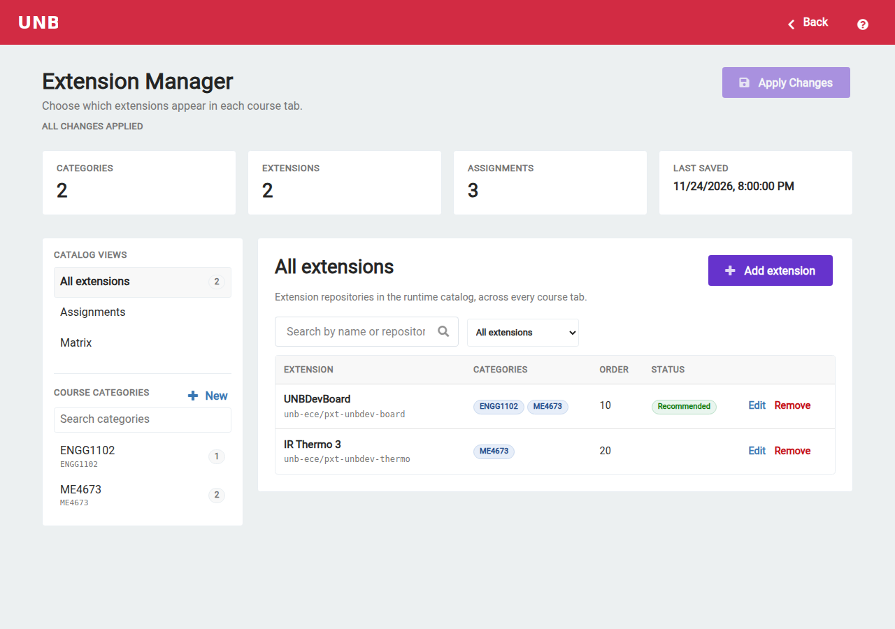
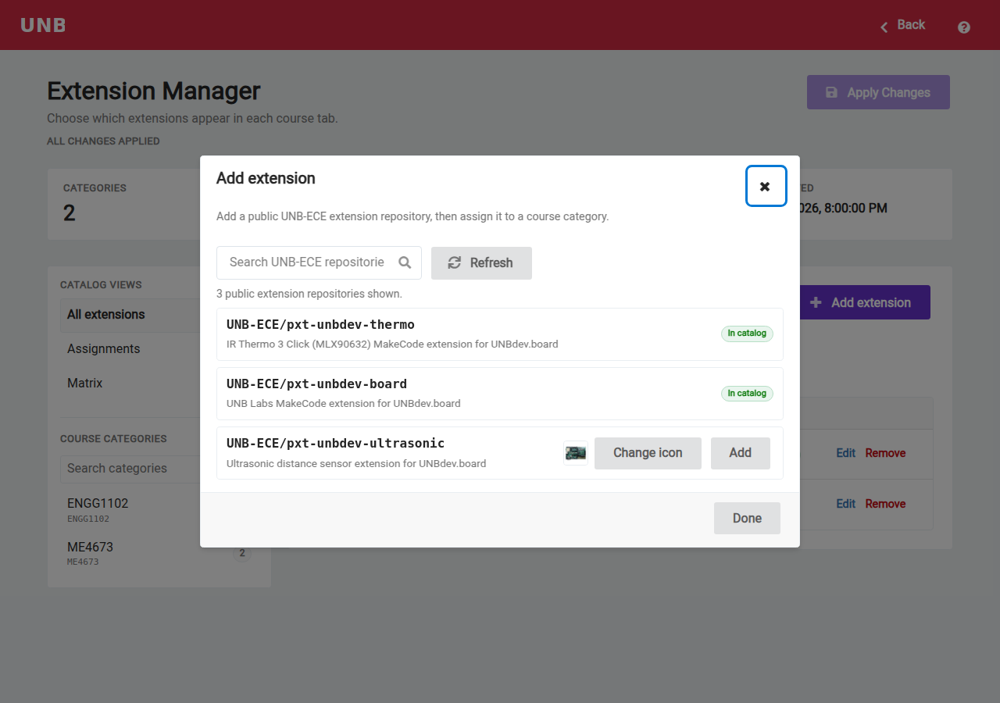
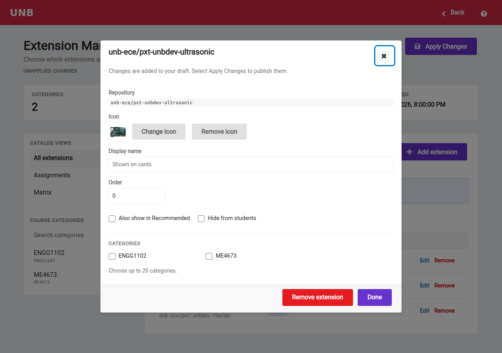

# Authoring and Publishing Custom Extensions for the UNB IDE

This guide provides end-to-end instructions for course instructors, instructional designers, and junior developers creating and publishing custom extensions for the UNBDev Board in the UNB IDE. Sensor extensions are the worked example: each lives in the UNB-ECE organization, has its own repository and release tags, and is published to students through the Extension Manager.

This repository, [`UNB-ECE/pxt-unbdev-board`](https://github.com/UNB-ECE/pxt-unbdev-board), is the layout reference; the worked example is `UNB-ECE/pxt-unbdev-ultrasonic`. Course lessons use a separate content repository; see the [course tutorial development guide](https://github.com/UNB-ECE/unb-platform/blob/main/docs/tutorials/course-tutorial-development-guide.md).

## Why this guide exists

This guide is for an instructor who is developing a custom extension for the UNBDev Board: a sensor, actuator, or other hardware module that students use with the board. It covers the whole path from a new UNB-ECE repository to a card that appears in the right course category.

An extension is resolved from GitHub when a student adds it to a project. Two publication layers control what students see:

- **The release tag** identifies the exact extension code. MakeCode installs the newest semantic-version tag, or the default-branch head when no tag exists.
- **The runtime catalog** decides which repositories appear in which course category. The Extension Manager maintains it.

Changing either layer changes the student experience directly. There is no editor rebuild between a manager apply and the next student load, and no staging copy that catches a mistake first. An untested block, an untagged repository, or a wrong category assignment can reach a class immediately. This guide makes that path repeatable for every instructor building an extension for the board.

> [!IMPORTANT]
> At the time of writing (2026-11-22), the management service is not deployed. The Extension Manager at `/extension-manager` is read-only: it shows the published catalog, disables editing, and offers **Download JSON**. Until the administrator updates the auth and editor-site stacks, prepare and tag the repository and coordinate the catalog change with the administrator.

## The extension development flow

An extension moves through nine stages:

1. **Design the layout.** Follow `pxt-unbdev-board`: manifest, TypeScript modules, tests, `docs/`, and `icon.png`.
2. **Create the repository.** Create a public `UNB-ECE/pxt-unbdev-<sensor>` repository with an initial `pxt.json`.
3. **Open it in the IDE.** Import the repository so commits and releases go to it directly.
4. **Author the extension.** Write the blocks, manifest, help pages, and tests.
5. **Test and record evidence.** Check the compiler, the simulator, and the physical board.
6. **Commit and push.** Review the diff and commit in the GitHub dashboard.
7. **Create the release.** Publish the tag students install.
8. **Publish and assign categories.** Add the repository in the Extension Manager.
9. **Verify and maintain.** Confirm the student path, then release or retire the extension.

---

## 1. Design the Repository and Package Layout

A sensor extension is a MakeCode package: a manifest listing every source and help file, TypeScript modules with block annotations, tests, and documentation.

### Folder Layout

```text
pxt-unbdev-ultrasonic/
├── .github/workflows/ci.yml
├── docs/
│   ├── ultrasonic.md
│   ├── protocol.md
│   └── reference/
│       ├── README.md
│       └── ultrasonic/read-distance.md
├── LICENSE
├── README.md
├── THIRD_PARTY_NOTICES.md        # only if third-party code is used
├── icon.png
├── package.json
├── pxt.json
├── test.ts
└── ultrasonic.ts
```

| pxt-unbdev-board file | Sensor equivalent | Purpose |
|---|---|---|
| `pxt.json` | `pxt.json` | Manifest; lists every source and help page |
| `unbdev.ts`, `motor.ts`, `blixel.ts` | `ultrasonic.ts` | Block implementation |
| `test.ts` | `test.ts` | Tests with `control.assert` |
| `docs/motors.md` | `docs/ultrasonic.md` | Feature guide and protocol notes |
| `docs/reference/motors/run.md` | `docs/reference/ultrasonic/read-distance.md` | One help page per block |
| `README.md`, `icon.png`, `LICENSE` | same | Documentation, card image, licence |

If `UNB-ECE/pxt-sensor-extension-template` exists, use it and keep this layout.

### Manifest Contract (`pxt.json`)

Start from the board's [`pxt.json`](https://github.com/UNB-ECE/pxt-unbdev-board/blob/main/pxt.json). The final manifest lists every source and help page; `testFiles` runs only when the extension is the top-level project:

```json
{
    "name": "unbdev-ultrasonic",
    "version": "0.0.0",
    "description": "Ultrasonic distance sensor blocks for the UNBdev.board",
    "license": "MIT",
    "authors": ["UNB ECE"],
    "dependencies": {
        "core": "*"
    },
    "files": [
        "README.md",
        "ultrasonic.ts",
        "docs/ultrasonic.md",
        "docs/reference/ultrasonic/read-distance.md"
    ],
    "testFiles": [
        "test.ts"
    ],
    "public": true,
    "supportedTargets": [
        "microbit"
    ]
}
```

If the extension calls UNBdev.board APIs, pin an approved board release:

```json
"dependencies": {
    "core": "*",
    "unbdev-board": "github:UNB-ECE/pxt-unbdev-board#v0.3.0"
}
```

Never use `main` as the dependency version. Copy the board's `disablesVariants: ["mbdal"]` only when your extension has the same micro:bit V2 constraint.

> [!IMPORTANT]
> A TypeScript file that exists but is not listed in `pxt.json` contributes no blocks, and `pxt test` can still pass. The board's CI checks every top-level `.ts` file against the manifest for this reason.

Course categories, ordering, and visibility belong to the Extension Manager, not the manifest. See MakeCode's [pxt.json reference](https://makecode.com/extensions/pxt-json).

### Repository and Package Names

- Repository: `pxt-unbdev-<sensor>` under [UNB-ECE](https://github.com/UNB-ECE), for example `pxt-unbdev-ultrasonic`.
- Package `name`: `unbdev-<sensor>`, without the `pxt-` prefix; namespace `UNBdev<Sensor>`.
- Block category label: `UNBdev <sensor>`.
- Visibility: public, with a description that mentions MakeCode, pxt, or micro:bit and the `makecode` topic.

Do not put a course code in the repository name. A category is manager-owned metadata, and one extension can belong to several.

---

## 2. Create the Repository in UNB-ECE

Create a new repository rather than forking `pxt-unbdev-board`: a fork keeps the board's history and identity. If a starter template exists, create from it and confirm it contains a `pxt.json`. You need permission to create repositories in the organization.

1. Sign in to GitHub and open [github.com/UNB-ECE](https://github.com/UNB-ECE).
2. Select **New repository**.
3. Set **Repository name** to `pxt-unbdev-<sensor>`, add a description, select **Public**, select **Add a README file** so the repository has a default branch, and select **Create repository**.
4. Select the gear beside **About**, add the `makecode` topic, and save.
5. Select **Add file** → **Create new file**, name it `pxt.json`, and paste the starting manifest below. Commit to the default branch, normally `main`, or create a branch and pull request if the organization requires review.

```json
{
    "name": "unbdev-ultrasonic",
    "version": "0.0.0",
    "description": "Ultrasonic distance sensor blocks for the UNBdev.board",
    "license": "MIT",
    "authors": ["UNB ECE"],
    "dependencies": {
        "core": "*"
    },
    "files": [
        "README.md"
    ],
    "public": true,
    "supportedTargets": [
        "microbit"
    ]
}
```

The starting manifest lists only the files that exist. Section 4 adds the rest and updates `files`.

> [!IMPORTANT]
> The UNB IDE cannot create organization repositories. Its GitHub button and **Create a new repository for this project** option create repositories under your personal account only. Create the UNB-ECE repository on github.com, then import it.

---

## 3. Open the Repository in the UNB IDE

1. Open the deployed editor: [https://d200xhrnashxy5.cloudfront.net](https://d200xhrnashxy5.cloudfront.net).
2. On the Home page, select **Import**, then **Your GitHub Repo...**.
3. If prompted, select **Sign in with GitHub** and authorize repository access. The dialog reopens after the redirect; the editor never asks for a password or personal access token.
4. Select **Repository** (`UNB-ECE/pxt-unbdev-ultrasonic`), **Branch** (`main`), and **Project folder** (**Top level**).
5. Select **Open project**.

The project is linked to the repository, not copied from it. The Explorer opens with the repository files, the GitHub button shows the repository name, and dashboard commits go to the same branch. The project also appears under **My Projects**, so later sessions reopen it without importing.

If the repository does not appear in the list, confirm your UNB-ECE membership and repository access, and ask the organization owner to approve the OAuth App if the organization restricts third-party applications.

If the branch has no valid `pxt.json`, the dialog reports "This branch has no pxt.json file, so there is no MakeCode project to open." Commit the manifest as described in section 2, then reload.

---

## 4. Edit the Extension in the UNB IDE

Open files from the **Explorer**. TypeScript opens in the text editor, Markdown in the documentation editor with a preview, and `pxt.json` in the project settings form.

### Edit the TypeScript Modules

1. Open the sensor module, for example `ultrasonic.ts`.
2. Define each block with MakeCode annotations:

```typescript
/**
 * Ultrasonic distance sensor blocks for the UNBdev.board.
 */
//% weight=98 color=#008080 icon="" block="UNBdev ultrasonic"
namespace UNBdevUltrasonic {
    /**
     * Read the distance to the nearest object.
     * @param echo pin connected to the sensor echo signal
     */
    //% blockId=unbdev_ultrasonic_read_distance
    //% block="read distance (cm) on pin $echo"
    //% echo.defl=DigitalPin.P0
    //% group="Distance"
    //% weight=100
    export function readDistance(echo: DigitalPin): number {
        // Replace with the validated sensor protocol.
        return 0;
    }

    /** Convert a pulse duration to centimetres; internal helper. */
    //% blockHidden=true
    export function convertPulse(microseconds: number): number {
        return Math.round(microseconds / 58);
    }
}
```

3. Use a sensor-specific namespace. Do not add blocks to the board's `UNBdev` namespace, because block names collide when both extensions are installed.
4. Never change a released `blockId`; it is serialized into student Blocks projects. Add a new block and deprecate the old one. Keep labels short, with units and pin names, and set a safe `$param.defl`.

### Edit the Manifest

1. Open `pxt.json`; use the settings form for common fields, or **Edit settings as text** for the raw JSON.
2. Add every new source and help page to `files`, and the test file to `testFiles`.
3. Leave `version` at `0.0.0`; the release dialog writes the published version.

### Write the Help Pages

Each public block needs a page under `docs/reference/<group>/<block>.md`, listed in `pxt.json`:

````markdown
# Read distance

Read the distance to the nearest object in centimetres.

```sig
UNBdevUltrasonic.readDistance(DigitalPin.P0)
```

## Parameters

* **echo**: pin connected to the sensor echo signal.

## Example

```blocks
let distance = UNBdevUltrasonic.readDistance(DigitalPin.P0)
basic.showNumber(distance)
```

```package
unbdev-ultrasonic=github:UNB-ECE/pxt-unbdev-ultrasonic
```
````

Add the page to `docs/reference/README.md` and the manifest `files` list, then open it to check the preview. MakeCode's [block documentation guide](https://makecode.com/extensions/github-authoring) explains the fences.

### Add a File and Check the Blocks

1. Select the **+** in the Explorer header and enter a file name, for example `ultrasonic.ts`.
2. Register the file in `pxt.json` if it should ship; creating a file does not register it.
3. Switch to **Blocks** and confirm the `UNBdev <sensor>` category, groups, labels, defaults, and ordering, then right-click a block and select **Help** to confirm its page renders.

Binary files such as `icon.png` cannot be created in the editor. Upload them on github.com with **Add file** → **Upload files**, then commit.

---

## 5. Test and Record Evidence

Validation has three levels:

- **Compiler:** the manifest lists every file, and the blocks compile against the pinned target.
- **Simulator:** interaction, block appearance, grouping, defaults, and modeled behavior.
- **Physical board:** the sensor protocol works on the identified board, firmware, and hardware revision.

Compile the project, open the simulator, exercise every block, and check each default and help page. `test.ts` runs only when the extension is the top-level project; test pure helpers with `control.assert`:

```typescript
let distance = UNBdevUltrasonic.convertPulse(580)
control.assert(distance > 0, "pulse converts to a positive distance")
control.assert(UNBdevUltrasonic.convertPulse(0) == 0, "zero pulse is zero distance")
```

Keep hardware I/O out of unit tests. A simulator pass or a successful HEX/UF2 download does not prove that the sensor works. Download the program to the UNBdev.board with the sensor attached, then record the board and micro:bit revisions, firmware, editor build, extension tag or commit, program revision, expected and actual results, and pass/fail with evidence. Use [the BLiXel validation record](https://github.com/UNB-ECE/unb-platform/blob/main/docs/tutorials/blixel-validation.md) as the template and see [the UNBdev.board TypeScript API training](https://github.com/UNB-ECE/unb-platform/blob/main/docs/training/unbdev-board-typescript-api-training.md) for the evidence vocabulary.

Copy the board's [CI workflow](https://github.com/UNB-ECE/pxt-unbdev-board/blob/main/.github/workflows/ci.yml) and `package.json` scripts. It checks that every top-level `.ts` file is listed, installs the target and dependencies, then runs `pxt test` and the build. A green CI run is not a hardware verification.

---

## 6. Commit and Push in the GitHub Dashboard

The dashboard shows what changed, commits it with a message you write, and pushes it to the repository. It works through your GitHub sign-in; the editor never writes the token to browser storage. **Save** keeps the project in this browser; it does not publish to GitHub.

1. Select the **GitHub** button in the bottom toolbar, next to **Save**. Its icon shows an up arrow when local changes need a commit and a check when the branch is synchronized.
2. If the pane asks you to sign in, select **Sign in with GitHub**.
3. Review the files under **There are local changes.** Select **Revert** or **Revert all** to discard local changes; reverting cannot be undone.
4. Enter a **Commit Message**, for example `feat(ultrasonic): add distance blocks`.
5. Select **Commit and push changes**.

The pane pulls the branch first, refuses to commit while conflict markers remain, commits the project tree, and pushes. If the branch cannot be advanced, it opens a pull request. If a conflict appears, resolve it with **Keep local**, **Keep remote**, or **Keep both**, then commit again. If someone else pushed first, select **Pull changes** and review the incoming diff.

### Command Equivalent

```bash
git add pxt.json ultrasonic.ts test.ts README.md icon.png docs
git commit -m "feat(ultrasonic): add distance blocks"
git push origin main
```

---

## 7. Create the Release in the GitHub Dashboard

A release is the exact code a student installs. The dashboard creates the version bump, commit, GitHub release, and tag in one action. The Release zone appears only on a branch named `main` or `master`, and only when the working tree is clean.

1. Confirm the branch label beside the repository name reads `#main` (or `#master`). To switch, select the label and choose a branch under **Switch to a different branch**.
2. Commit and push any local changes; the zone hides while changes are pending.
3. In the **Release zone**, select **Create release**.
4. In **Pick a release version**, choose **patch** for bug fixes, **minor** for an added function or optional parameters, or **major** for renamed functions or deleted parameters or functions.
5. Leave **Optimize for tutorials by caching information about the markdown** unchecked; it adds a tutorial cache file and a second commit, which a sensor extension does not need.
6. Select **Create release**.

The choices are computed from the newest remote tag, not from `pxt.json`. With no tag, the base is `0.0.0`, so the choices are `0.0.1`, `0.1.0`, and `1.0.0`; select major to publish the first release as `v1.0.0`. The editor then writes the chosen version into `pxt.json`, commits it with the version as the message, creates the published release and `v<version>` tag, and enables GitHub Pages. The zone shows **Current release: v<version>**.

If the zone shows **Current release: main** on a freshly imported repository and no **Create release** button, the import recorded the branch name where the release tag belongs. Make one commit through the dashboard as described in section 6; the button then appears.

> [!WARNING]
> Never move or delete a published tag. Student projects pin the tag they installed. If a release is wrong, fix the code and publish a new patch release.

A new tag does not update existing student projects; students remove and re-add the extension to move to a newer tag. See MakeCode's [versioning guide](https://makecode.com/extensions/versioning).

### Command Equivalent

```bash
# 1. Set the version in pxt.json, then commit it
git add pxt.json ultrasonic.ts docs
git commit -m "1.0.0"
git push origin main

# 2. Create the tag and the published GitHub release
git tag -a v1.0.0 -m "UNB ultrasonic sensor v1.0.0"
git push origin v1.0.0
gh release create v1.0.0 --title v1.0.0 --notes "First published release"
```

---

## 8. Review a Pull Request (Optional)

You do not need a fork. Instructors with write access can commit directly to `main`, or use a branch and pull request inside the same repository when a change needs review. Branch protection may require the pull request route.

1. Select the `#main` label and choose **Create new branch**; enter a name such as `feat-ultrasonic-distance` and select **Create**.
2. Commit and push as described in section 6.
3. Select **Create pull request**, add a title and description, and confirm.
4. In the pull request zone, select **Merge pull request** and choose squash, merge, or rebase. Use **Update branch** when out of date, or **Resolve conflicts** when needed.
5. Switch back to `#main` and select **Pull changes**.

The reviewer list can be incomplete for UNB-ECE repositories because reading organization reviewers needs a scope the editor sign-in does not request. Approvals can always be given on github.com.

### Command Equivalent

```bash
git checkout -b feat-ultrasonic-distance
git push -u origin feat-ultrasonic-distance
gh pr create --base main --head feat-ultrasonic-distance \
  --title "feat(ultrasonic): add distance blocks"
gh pr merge --squash --delete-branch
git checkout main && git pull
```

---

## 9. Publish through the Extension Manager

The manager at `/extension-manager` reads the custom extension repository list from UNB-ECE and writes the runtime catalog the editor reads; it does not build or test the extension. The GitHub-auth service uses your token server-side to list repositories and to read and write `runtime/extension-catalog.json`. It validates the catalog and uses an ETag so two instructors cannot silently overwrite each other. The editor merges the catalog's categories ahead of the static `targetconfig.json` categories. No rebuild or redeployment is needed.

You need a GitHub account with access to UNB-ECE, its numeric ID on the administrator's `AdminGitHubIds` list, the deployed management service, and a public extension repository with a `pxt.json` and a release tag.

### Open the Manager

1. Open the **Extensions** dialog: in **Blocks**, select **Extensions** at the bottom of the toolbox; in **JavaScript**, open the **Settings** menu and select **Extensions**.
2. Select the gear in the dialog's top-right header, titled **Manage extension categories**.
3. If signed out, select **Sign in with GitHub**. You return to `/extension-manager`.
4. If the page says your account cannot manage extensions, select **Copy ID** and ask the administrator to add the number to `AdminGitHubIds`.
5. The question-mark icon in the app bar opens the
   [in-app help page](https://d200xhrnashxy5.cloudfront.net/help.html).



### Add the Repository

1. Select **Add extension**.
2. Choose **UNB-ECE repositories**. The list contains only public UNB extension repositories (`pxt-*`), most recently updated first (up to 300); private repositories and the editor/platform repositories are not listed. Search by name, slug, or description. Use **Icon** on the row to choose an optional image; it is fitted to 128 px and stored with the catalog entry, then select **Add**.



The list is a discovery aid, not a trust check: archived repositories are frozen, and the manager does not read `pxt.json`. If the repository is missing, select **Refresh**; a repository outside the public `pxt-*` set cannot be added from this dialog.

### Assign Course Categories

1. Select **All extensions** in the left rail, then **Add extension**, or open a category first so the repository is assigned immediately.
2. Assign categories in one of three ways: **Edit** on the extension row sets the display name, icon, order, **Also show in Recommended**, **Hide from students**, and category checkboxes (up to 20); **Assignments** lists a category's extensions with All, Assigned, and Not assigned filters and bulk changes; **Matrix** shows extensions as rows and categories as columns, with at most ten columns and a filter for the rest.



A category ID is permanent and must match `^[A-Za-z0-9][A-Za-z0-9_-]{0,31}$`, for example `ENGG1102`. Create categories with **New category**. Deleting a category removes its tab and assignments but keeps its extensions; a hidden category keeps its assignments but shows no tab.

### Apply and Resolve a Conflict

Select **Apply Changes**. The manager sends the whole catalog and the ETag it loaded; validation problems disable Apply Changes and are listed above the workspace. If another instructor applied first, the conflict dialog offers **Load latest**, **Keep editing**, or **Download my changes**. A successful apply shows **Changes applied**; students see the change on their next load, or after the five-minute cache expires.

### What the Manager Does Not Do

- It does not build, compile, or test extension code, verify an add-by-name repository, pin a version, or replace GitHub permissions.
- It does not publish through `targetconfig.json`. Do not edit `software/pxt-microbit/targetconfig.json` to publish a course extension: that file is regenerated from the release artifact, deploy syncs use `--delete`, and the editor caches it for 24 hours.

### If the Manager Is Read-Only

The page shows **Editing is unavailable** and replaces Apply Changes with **Download JSON**. Inspect the catalog with the download, or ask the administrator to deploy the management service. A coordinated upload of a validated replacement to `runtime/extension-catalog.json` is the fallback; it bypasses the manager's ETag and validation safeguards.

---

## 10. Verify the Published Extension

1. Open a clean editor session or a private window.
2. Open **Extensions**, select the course category, and confirm the card appears.
3. Add the extension and verify the blocks, groups, defaults, and help pages.
4. Compile the program and run it in the simulator.
5. Download it to the UNBdev.board with the sensor attached and run the physical test.
6. Open the project's `pxt.json` and confirm the dependency uses the expected tag or commit SHA.

If the card is missing, check the category assignment, hidden flags, category visibility, and the five-minute cache. If the install fails, check that the repository is public, `pxt.json` is valid, a tag exists, and the repository was not renamed. Record the verification date, editor build, tag, and result.

---

## 11. Maintain, Roll Back, and Deprecate

### Release Versioning

- **Patch** (`v1.0.1`): a bug fix with no API change.
- **Minor** (`v1.1.0`): a backward-compatible block or feature.
- **Major** (`v2.0.0`): a breaking API or block-ID change; keep the old block for a migration period where possible.

Never change a released `blockId`. Update the README, feature page, help pages, tests, and evidence with every release. A new tag does not require re-adding the repository to the catalog; catalog edits are only for display name, icon, order, Recommended, hidden, or categories.

### Roll Back a Published Change

- **Code:** never move or delete the tag. Fix the defect, publish a new patch release, and tell instructors to re-add the extension in projects that pinned the bad tag.
- **Catalog:** restore the previous display name, order, visibility, and categories and select **Apply Changes**. Enable **Hide from students** to withdraw an extension immediately. **Remove** deletes the catalog entry; the repository is unchanged.
- **Rename or transfer:** update the catalog entry, because old projects point at the old slug.

### Deprecate an Extension

Publish a final release tag, add a replacement notice to the README, hide the extension in the manager, and tell instructors what replaces it. Archive the repository only after removing it from the catalog.

---

## Review Checklist

- [ ] Repository is public, under `UNB-ECE`, named `pxt-unbdev-<sensor>`, and carries a MakeCode topic and description.
- [ ] `pxt.json` lists every TypeScript source and help page in `files`, with the test file in `testFiles`.
- [ ] Blocks have stable `blockId`s, units, defaults, groups, and help pages.
- [ ] `test.ts` contains real assertions and compiles as a top-level project.
- [ ] `README.md`, `icon.png`, `LICENSE`, and the block reference pages are present.
- [ ] Simulator and physical evidence record the board, firmware, extension revision, program revision, and result.
- [ ] Changes are committed and pushed, and a `vMAJOR.MINOR.PATCH` release tag points at the tested commit.
- [ ] The repository is added to the manager, assigned to the correct categories, not hidden, and applied.
- [ ] A clean project shows the card, installs the blocks, compiles, and passes the physical test.
- [ ] No direct edits were made to `software/pxt-microbit/targetconfig.json`.

## Troubleshooting

| Symptom | Likely cause | Action |
|---|---|---|
| "This branch has no `pxt.json` file" on import | The branch has no valid manifest | Commit `pxt.json`, then reload the dialog |
| GitHub button shows a create-repository icon | The project is not linked to a repository | Import it as described in section 3 |
| Repository missing from Add extension | Older than the 300 most recent, archived, private, or not a public `pxt-*` extension | **Refresh**; if it is outside the public `pxt-*` set, make it public and follow the naming convention |
| Apply Changes disabled | Validation issue, duplicate repository, unknown category, or the 20-category cap | Fix the issues listed above the workspace |
| Apply Changes returns a conflict (409) | Another instructor applied first | Load latest, keep editing, or download your changes |
| "Editing is unavailable" or read-only | Admin API not deployed, network failure, or expired session | Sign in again or ask the administrator |
| "This account can't manage extensions" | Numeric GitHub ID missing from `AdminGitHubIds` | Copy the ID and request the allowlist update |
| Change not visible to students | Five-minute cache, or the catalog was not applied | Reload the editor and check `/runtime/extension-catalog.json` |
| Card missing from a category | Not assigned, hidden, or the category is hidden | Edit the extension or category |
| **Create release** missing | Local changes pending, not on `main`/`master`, or the import's branch marker is showing | Commit and push, switch to the default branch, or make one dashboard commit |
| Release choices are not what I expected | Choices are patch/minor/major from the newest remote tag | Choose the closest correct bump, or create the exact tag with Git |
| Student install fails | Private or archived repository, invalid manifest, missing tag, renamed repository, or unsupported target | Make it public, fix the manifest, publish a release, update the catalog |
| Blocks missing after install | A source file is missing from `pxt.json`, or the extension did not compile | Register the file, run `pxt build` / `pxt test`, publish a tag |
| Version did not update | The student project pins the old tag | Publish a new tag; remove and re-add the extension |

## References

Platform documentation in [`UNB-ECE/unb-platform`](https://github.com/UNB-ECE/unb-platform):

- [Sensor extension workflow and catalog design](https://github.com/UNB-ECE/unb-platform/blob/main/docs/design/sensor-extension-workflow-and-catalog-design.md)
- [Runtime extension catalog and Extension Manager design](https://github.com/UNB-ECE/unb-platform/blob/main/docs/design/runtime-extension-catalog-and-manager-design.md)
- [Extension Manager interface design](https://github.com/UNB-ECE/unb-platform/blob/main/docs/ui/extension-manager-interface-design.md)
- [PXT repository folder guide](https://github.com/UNB-ECE/unb-platform/blob/main/docs/project-management/pxt-repository-folder-guide.md)
- [BLiXel validation record](https://github.com/UNB-ECE/unb-platform/blob/main/docs/tutorials/blixel-validation.md)
- [UNBdev.board TypeScript API training](https://github.com/UNB-ECE/unb-platform/blob/main/docs/training/unbdev-board-typescript-api-training.md)
- [Course tutorial development guide](https://github.com/UNB-ECE/unb-platform/blob/main/docs/tutorials/course-tutorial-development-guide.md)

External:

- [pxt-unbdev-board repository](https://github.com/UNB-ECE/pxt-unbdev-board)
- [pxt-unbdev-board manifest](https://github.com/UNB-ECE/pxt-unbdev-board/blob/main/pxt.json)
- [pxt-unbdev-board CI workflow](https://github.com/UNB-ECE/pxt-unbdev-board/blob/main/.github/workflows/ci.yml)
- [Canonical tutorial development guide](https://github.com/UNB-ECE/unb-tutorials/blob/main/docs/tutorial-development-guide.md)
- [MakeCode extension getting started](https://makecode.com/extensions/getting-started)
- [MakeCode pxt.json reference](https://makecode.com/extensions/pxt-json)
- [MakeCode versioning guide](https://makecode.com/extensions/versioning)
- [MakeCode GitHub authoring guide](https://makecode.com/extensions/github-authoring)
- [MakeCode block annotations](https://makecode.com/defining-blocks)
